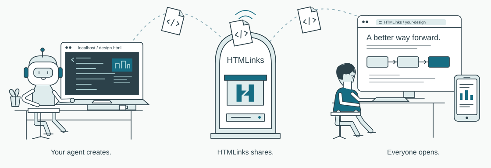

<p align="center">
  <a href="https://htmlinks.com">
    
  </a>
</p>

<p align="center">
  <a href="LICENSE"></a>
  <a href="skills/htmlinks/SKILL.md"></a>
  <a href="#self-host"></a>
</p>

<p align="center">
  <strong><a href="https://htmlinks.com">HTMLinks.com</a></strong> · <a href="#quick-start">Quick start</a> · <a href="#examples">Examples</a> · <a href="docs/USAGE.md">CLI & API</a> · <a href="docs/DEPLOYMENT.md">Deployment</a>
</p>

# HTMLinks - HTML publishing for AI agents

Your coding agent made an HTML document on your computer. **HTMLinks gives it a shareable link.** Use a simple skill to upload design docs, reports, and presentations. People can open them in their browser. Update a document later and keep the same link. Add a password when needed.

Built for **Claude Code, Codex, and agents that support Agent Skills**. Publish through the live managed service at **[HTMLinks.com](https://www.htmlinks.com)** with no account or API-key setup, or self-host with Docker and keep your documents on your own infrastructure.

<p align="center">
  
</p>

## Why I built HTMLinks

Creating documents with AI coding agents is becoming common. But the files usually stay on your computer, which makes them harder to share.

I built HTMLinks to make sharing them simple: upload an HTML document through a skill and get a link people can open in their browser. You can keep editing the document with your agent and update the shared version at the same link. If you need password protection, you can add it too.

## What you get

|                               | What you get                                                                          |
| ----------------------------- | ------------------------------------------------------------------------------------- |
| 🔗 **One lasting link**       | Revise, roll back, and share again without sending a new URL.                         |
| ⚡ **Agent to browser**       | An Agent Skill and standalone Node.js CLI publish the file your agent already made.   |
| 🎛️ **HTML stays interactive** | Inline CSS, JavaScript, embedded visuals, charts, and slide controls work.            |
| 🔐 **Choose who opens it**    | Unlisted links or server-checked passwords, plus optional expiry.                     |
| 📦 **Own the hosting**        | Docker Compose, PostgreSQL, and filesystem or private Supabase Storage. MIT licensed. |

## Quick start

Requires **Node.js 22.22+**. Use the managed service at [HTMLinks.com](https://www.htmlinks.com), or [run your own instance](#self-host). Install the skill:

```sh
npx skills add michael-elkabetz/HTMLinks --skill htmlinks
```

Choose your agent when prompted and reload its skills. Then ask:

> Use HTMLinks to publish `./report.html` through managed hosting at `https://www.htmlinks.com`. Anyone with the link can view it.

The skill configures and remembers that destination. Shared pages open at `https://www.htmlinks.com/rendered/<public-id>`. For password protection, ask:

> Publish `./report.html` with password protection. Ask me which password to use before uploading.

Later:

> Update that HTMLinks document with `./report-v2.html`. Keep the same link.

The skill remembers your hosting choice and saves each document's private management key locally. Recipients only need a browser. [Read the skill](skills/htmlinks/SKILL.md) for password-protected uploads and the full workflow. Upgrading an existing instance? See the [upgrade notes](docs/DEPLOYMENT.md#upgrading-from-the-previous-name).

To install from a local checkout instead, run `npx skills add . --skill htmlinks`. The GitHub helper defaults managed hosting to the live service. Saved hosting preferences are preserved; to correct an older managed preference pointing at localhost, run:

```sh
node skills/htmlinks/scripts/htmlinks.mjs config --hosting managed --url https://www.htmlinks.com
```

## Self-host

Requires **Docker with Compose v2.20+** and a POSIX shell (Linux, macOS, or WSL2). No Node.js installation or source checkout is needed on the server. Download the deployment bundle:

```sh
curl -fL https://github.com/michael-elkabetz/HTMLinks/releases/download/v0.1.0/htmlinks-0.1.0.tar.gz -o htmlinks.tar.gz
tar -xzf htmlinks.tar.gz
cd htmlinks
sh setup.sh
docker compose up -d --wait
```

Open [localhost:3000](http://localhost:3000). Images support Linux AMD64 and ARM64. Setup generates unique secrets and preserves existing configuration. For a public instance, use `sh setup.sh --url https://htmlinks.example.com` before the first start and configure an HTTPS reverse proxy. The web service serves the site, publishing API, and shared pages at `/rendered/<public-id>`; uploaded HTML stays in an opaque sandbox. See [deployment and upgrades](docs/DEPLOYMENT.md) and the [same-domain hosting guide](docs/SHARED-DOMAIN.md).

The publishing helper still requires Node.js 22.22+ on your agent's computer. From a source checkout:

```sh
node skills/htmlinks/scripts/htmlinks.mjs config --hosting self-hosted --url http://localhost:3000
node skills/htmlinks/scripts/htmlinks.mjs upload examples/idea.html
node skills/htmlinks/scripts/htmlinks.mjs update <document-id> ./revised.html
```

[CLI, API, and development instructions →](docs/USAGE.md)

To build the image from source instead, clone this repository, run `node scripts/init.mjs`, then `docker compose -f compose.yaml -f compose.build.yaml up --build -d --wait`.

## Examples

Explore the interactive [example gallery on HTMLinks.com](https://www.htmlinks.com/#examples). Self-hosting? Open **Examples** on your instance’s home page, such as [localhost:3000](http://localhost:3000/#examples).

The HTML source files are also included: [idea doc](examples/idea.html), [technical design](examples/technical.html), and [presentation](examples/presentation.html). GitHub shows their source; download a file and open it in your browser to view it directly.

## What can I publish?

Self-contained UTF-8 `.html` / `.htm` files up to **10 MiB**. Embed styles, scripts, images, and fonts in the file. Useful for LLM-generated documents, technical proposals, interactive explainers, and agentic workflows that produce HTML artifacts.

External scripts, network requests, browser storage, forms, popups, and nested frames are blocked. PDF, PPTX, DOCX, ZIP bundles, and multi-file sites are unsupported.

Anyone with an unlisted link can read it. Passwords gate delivery; authorized readers can still copy the content. Editing keys stay in `~/.config/htmlinks/`-back up that directory, because a share link cannot recover editing access. Deleted documents can be restored within the retention window, seven days by default.

## Contribute

Bug reports, documentation fixes, and useful HTML examples are welcome. See [Contributing](CONTRIBUTING.md), [Security](SECURITY.md), and the [development checks](docs/USAGE.md#development-and-checks).

Built with Next.js, React, TypeScript, and PostgreSQL. Maintained by [Michael Elkabetz](https://github.com/michael-elkabetz). [MIT license](LICENSE).

**If HTMLinks helps you share what your agent builds, give it a ⭐ and share the project.**
